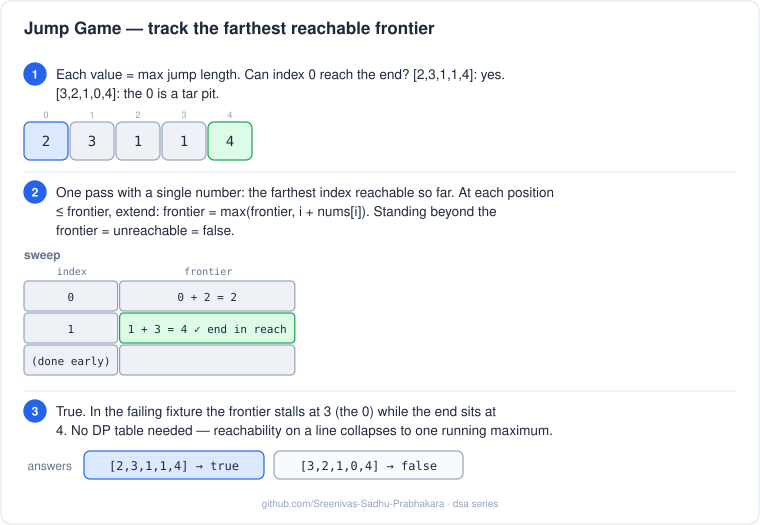

# Jump Game

> NeetCode 150 · Greedy · Blind 75 — carry the farthest reachable index; standing beyond it is the only way to fail. Go, stdlib only, tested.

## Problem

Each cell holds a maximum hop length; starting at index 0, can the last index be reached? `[3,2,1,0,4]` strands on the 0.

## Approach

The DP framing ("is each index reachable?") works at O(n²); the greedy collapse is noticing reachability is an *interval*: if index k is reachable, so is everything before it, so a single frontier — the max of `i + nums[i]` over visited i — summarizes all history. Walk left to right: an index beyond the frontier is unreachable (and so is everything after), otherwise extend the frontier. The loop's two lines are a worked example of proving a greedy by invariant: "after processing i, `reach` is exactly the farthest index reachable using the first i+1 cells."

**Complexity:** O(n) time, O(1) space.

## Visual walkthrough

Read the picture top to bottom — each numbered frame is one moment of the algorithm
running on this repo's test example.

## Run

    go test ./...   # verify
    go run .        # demo

---

Part of a 275-repo DSA series in Go — Striver's SDE Sheet (dsa-001–191) plus the NeetCode 150 / Blind 75 additions (dsa-192–275), stdlib only, every solution tested. Browse: [`dsa-*` repos](https://github.com/Sreenivas-Sadhu-Prabhakara?tab=repositories&q=dsa-&type=source).
